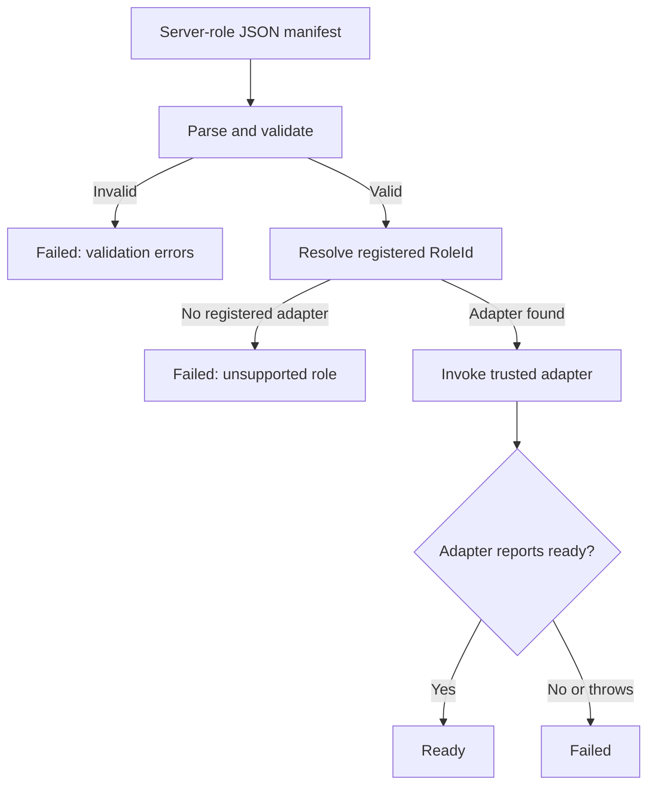

<!-- The Singularity Workshop moniker -->
<p align="center"><a href="https://github.com/TrentBest"></a></p>

# Server Role Manifest — First Contract

## Purpose

A ServerApp server-role manifest describes **one requested server instance**: its role identifier, instance identity, declared dependencies, and resource requirements. It is distinct from the FSM_COS `RuntimeManifest`, which identifies MicroBundles and versions to compose into a runtime.

The ServerApp manifest asks: *what server role should be provisioned, with what declared capacity and prerequisites?* The FSM_COS manifest asks: *which MicroBundles and versions should be composed?* A server-role adapter may invoke FSM_COS internally when that role requires composition, but the two contracts remain separate.

## Version 1 shape

The versioned machine-readable schema is [server-role-manifest.v1.schema.json](../schemas/server-role-manifest.v1.schema.json). The first proof uses this JSON shape:

```json
{
  "SchemaVersion": 1,
  "InstanceId": "local-diagnostic-001",
  "RoleId": "diagnostic.ready",
  "Dependencies": [],
  "Resources": {
    "CpuCores": 1,
    "MemoryMiB": 128
  }
}
```

| Field | Meaning |
|---|---|
| `SchemaVersion` | Required schema version. The first implementation accepts only 1. |
| `InstanceId` | Caller-assigned identity for this requested instance. |
| `RoleId` | Stable role key resolved against an explicitly registered adapter. |
| `Dependencies` | Instance IDs that must already be `Ready` in the same in-process coordinator before this instance can start. These are server-instance dependencies, not MicroBundle dependencies. |
| `Resources.CpuCores` | Requested CPU core capacity; validation currently accepts 1–1024. |
| `Resources.MemoryMiB` | Requested memory in MiB; validation currently accepts 64–1,048,576. |

Unknown JSON properties are rejected. The JSON Schema is the published structural contract; the runtime validator enforces the current implementation's supported version, identifier rules, duplicate-dependency rule, and resource bounds. The first implementation also rejects missing/invalid identifiers, duplicate dependency names, unsupported schema versions, and out-of-range resource requests.

## Provisioning flow

This is the intended control flow of the first local proof. The diagram is source-aligned with the coordinator and registered adapter boundary; it does not depict distributed placement or a running production service.



## Provisioning boundary

The initial local coordinator performs these steps:

1. Validate the manifest.
2. Resolve `RoleId` only against an adapter registered by the host.
3. Require every declared dependency instance ID to be registered as `Ready` in this coordinator.
4. Reject duplicate instance activation while an instance is starting or after it is ready.
5. Invoke the adapter with the manifest and cancellation token.
6. Register the instance as `Ready` only when the adapter explicitly reports readiness; otherwise report `Failed`.

The manifest cannot name an assembly, executable, shell command, URL, or arbitrary code payload. There is no dynamic code loading, network listener, distributed placement, persistent registry, or hardware resource reservation in this proof. The separate `ProvisioningPlanBuilder` now validates a closed batch, accepts explicitly supplied already-Ready external dependencies, rejects missing/self/cyclic dependencies, and returns a deterministic topological order. It does not activate adapters or change the coordinator's single-instance behavior. The coordinator still checks dependencies against previously Ready instances in its own process.

## Role adapter contract

`IServerRoleAdapter` is the explicit host extension point. The host constructs and registers trusted adapters. Each adapter declares one stable `RoleId` and reports whether its role has reached readiness. Adapter startup is not considered successful merely because a process or method was invoked.

The sample `diagnostic.ready` adapter is deliberately in-process and non-networked. It proves manifest parsing, validation, role lookup, activation dispatch, and readiness reporting—not a production server.

## Run locally

With .NET 8 SDK installed, from the repository root:

```bash
dotnet run --project src/ServerApp.Cli/ServerApp.Cli.csproj -- examples/diagnostic-ready.serverapp.json
dotnet run --project tests/ServerApp.ContractChecks/ServerApp.ContractChecks.csproj
```

The contract-check executable uses no third-party test packages. It checks successful activation, unsupported schema rejection, unknown-role fail-closed behavior, duplicate dependencies, invalid resource bounds, dependency readiness, duplicate instance activation, deterministic batch ordering, missing dependencies, cycle rejection, and explicitly Ready external dependencies.

## Status and next contract decisions

**Source-added; the latest verified CI run covers the prior dependency-readiness slice.** The new batch planner and its contract checks are awaiting their own CI run. This remains a local planning proof, not a production manifest contract.

The current dependency contract treats each dependency as a server instance ID. In batch planning, dependencies must resolve to another manifest in the batch or to an instance explicitly supplied as already Ready. The planner is not yet wired to adapter activation; that integration must preserve failure propagation and cancellation semantics. Remaining design steps include dependency lifecycle behavior when a prerequisite becomes unhealthy, resource units/limits and actual reservation, manifest provenance/signature and authorization, durable idempotency/reconciliation, adapter lifecycle and health, and the separation between requested capacity and measured capacity. Distributed placement should wait until the local lifecycle contract is stable.

---
<!-- THE SINGULARITY WORKSHOP FOOTER -->
<p align="center"></p>
